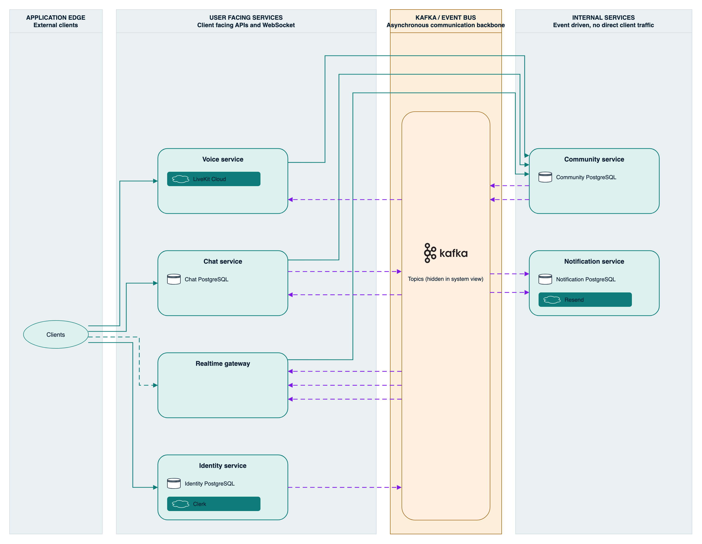

 
 

<strong>ARCHITECTURE-FIRST BACKEND GENERATOR</strong>

<h1>Design the backend system before you write it.</h1>

Describe your product. Delta AI designs a scalable, secure backend architecture,
writes the specification for every service, and opens the pull requests in your
GitHub organisation. Your code, your cloud, no lock-in.

 

<a href="https://app.delta-ai.dev"><strong>Start building →</strong></a>
&nbsp;&nbsp;·&nbsp;&nbsp;
<a href="https://delta-ai.dev">delta-ai.dev</a>
&nbsp;&nbsp;·&nbsp;&nbsp;
<a href="https://app.delta-ai.dev/docs">Documentation</a>

---

## What this is

This organisation holds a **complete backend system generated by Delta AI** from a
single product description — a Discord-style real-time communication platform.

Nothing here was hand-written. One prompt produced the architecture, the
specification set for every service, and the implementation of each service as a
reviewable pull request. The commit history is the record of that process.

It exists to show what the product actually produces, end to end, so you can read
the output rather than take a claim on trust.

## The system

Six domain-oriented TypeScript services, each a stateless Kubernetes deployment
exposing `/healthz` and `/readyz`:

| Service | Responsibility | State | External |
|---|---|---|---|
| [`identity_service`](https://github.com/delta-ai-dev-ext/6f4b-discord-style-real-time-communication-platform-identity-service) | Mirrors Clerk users, owns profile data | PostgreSQL | Clerk |
| [`community_service`](https://github.com/delta-ai-dev-ext/40e7-discord-style-real-time-communication-platform-community-service) | Communities, roles, permissions, moderation, audit log | PostgreSQL | — |
| [`chat_service`](https://github.com/delta-ai-dev-ext/97d5-discord-style-real-time-communication-platform-chat-service) | Message history, idempotent sends, transactional outbox | PostgreSQL | — |
| [`realtime_gateway`](https://github.com/delta-ai-dev-ext/45a0-discord-style-real-time-communication-platform-realtime-gateway) | WebSocket fan-out to connected clients | Stateless | — |
| [`voice_service`](https://github.com/delta-ai-dev-ext/c005-discord-style-real-time-communication-platform-voice-service) | Room access tokens, moderation enforcement | Stateless | LiveKit Cloud |
| [`notification_service`](https://github.com/delta-ai-dev-ext/fe49-discord-style-real-time-communication-platform-notification-service) | Transactional email, invite delivery | PostgreSQL | Resend |

The full specification — architecture, trust model, data ownership, API contracts,
failure modes — lives in the
[**system design repository**](https://github.com/delta-ai-dev-ext/3b75-discord-style-real-time-communication-platform-system-design).

## Read the output

Every service repository contains the same artefacts Delta AI produces for a real
project:

- **`docs/architecture.md`** — component boundaries, data flow, failure modes
- **`docs/openapi_spec.yaml`** — the complete HTTP contract
- **`docs/user_stories.md`** — testable acceptance criteria
- **`docs/engineering_guide.md`** — the conventions the implementation follows
- **`docs/decisions/`** — architecture decision records with the reasoning
- **`diagrams/`** — the service diagram, as `.drawio` and `.svg`
- **`src/` and `tests/`** — the implementation and its test suite

Start with [`chat_service`](https://github.com/delta-ai-dev-ext/97d5-discord-style-real-time-communication-platform-chat-service)
if you want the most representative example: it has the richest domain logic, a
transactional outbox, and a fail-closed dependency on `community_service`.

## How it was built

1. **Describe the product.** One paragraph, in plain language.
2. **Answer clarifying questions.** Delta AI asks what it needs to know — audience,
   scale, moderation requirements, success criteria.
3. **Review the architecture.** A system design with per-service credit estimates,
   before anything is generated.
4. **Approve each specification.** Every service gets its own plan and its own
   thread, reviewable in isolation.
5. **Review the pull requests.** Each service lands as a PR in your own GitHub
   organisation. Approve them, and Delta merges the change set as one group.

The whole system in this organisation was produced this way, in a single session.

## Reuse

Everything here is MIT licensed. Take it, run it, change it, ship it. See
[LICENSE](LICENSE).

It is a demonstration of what Delta AI generates, not a supported product. There
is no warranty of any kind, and no responsibility is accepted for how you use it.

---

Built by <a href="https://delta-ai.dev">Delta AI</a> · <a href="https://app.delta-ai.dev">app.delta-ai.dev</a>

