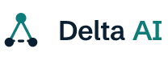
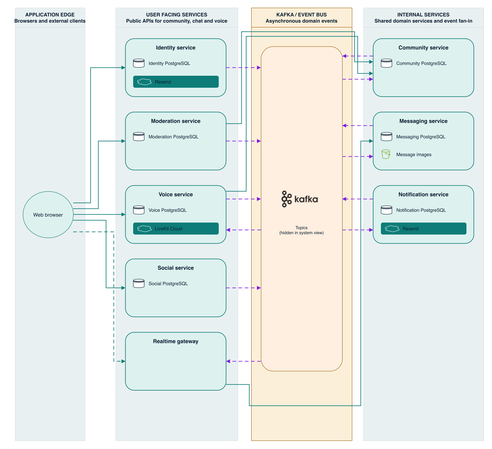

<div align="center">



<br />
<br />

<p><sub><strong>ARCHITECTURE-FIRST BACKEND GENERATOR</strong></sub></p>

<h1>Design the backend system before you write it.</h1>

<p>
Describe your product. Delta AI designs a scalable, secure backend architecture,
writes the specification for every service, and opens the pull requests in your
GitHub organisation. Your code, your cloud, no lock-in.
</p>

<br />

<p>
<a href="https://app.delta-ai.dev"><strong>Start building →</strong></a>
&nbsp;&nbsp;·&nbsp;&nbsp;
<a href="https://delta-ai.dev">delta-ai.dev</a>
&nbsp;&nbsp;·&nbsp;&nbsp;
<a href="https://app.delta-ai.dev/docs">Documentation</a>
</p>

</div>

---

## What this is

This organisation holds a **complete backend system generated by Delta AI** from a
single product description — a real-time community platform with text channels,
voice and video rooms, direct conversations and moderator tooling.

Nothing here was hand-written. One prompt produced the architecture, the
specification set for every service, and the implementation of each service as a
reviewable pull request. The commit history is the record of that process.

It exists to show what the product actually produces, end to end, so you can read
the output rather than take a claim on trust.

## The system

<div align="center">

</div>

Eight domain-oriented Go services, each a stateless container deployment exposing
`/healthz` and `/readyz`:

| Service | Responsibility | State | External |
|---|---|---|---|
| [`identity_service`](https://github.com/delta-ai-dev-ext/84f2-community-chat-voice-platform-identity-service) | Accounts, email verification, password reset, sessions, access-token issuance | PostgreSQL | Resend |
| [`community_service`](https://github.com/delta-ai-dev-ext/ae4e-community-chat-voice-platform-community-service) | Communities, channels, invites, memberships, roles & permissions | PostgreSQL | — |
| [`moderation_service`](https://github.com/delta-ai-dev-ext/a3f3-community-chat-voice-platform-moderation-service) | Sanctions (mute/kick/ban), audit log, appeals, automod rules | PostgreSQL | — |
| [`social_service`](https://github.com/delta-ai-dev-ext/f5d8-community-chat-voice-platform-social-service) | Friend requests, friendships, private conversations (DM / group DM) | PostgreSQL | — |
| [`messaging_service`](https://github.com/delta-ai-dev-ext/0621-community-chat-voice-platform-messaging-service) | Messages, threads, reactions, mentions, image attachments, automod enforcement | PostgreSQL | — |
| [`voice_service`](https://github.com/delta-ai-dev-ext/df7b-community-chat-voice-platform-voice-service) | Voice channel join/leave, capacity, presence, LiveKit integration | PostgreSQL | LiveKit Cloud |
| [`notification_service`](https://github.com/delta-ai-dev-ext/fc31-community-chat-voice-platform-notification-service) | In-app notification inbox, preferences, notification emails | PostgreSQL | Resend |
| [`realtime_gateway`](https://github.com/delta-ai-dev-ext/ebbc-community-chat-voice-platform-realtime-gateway) | WebSocket push of live events to browsers | Stateless | — |

The full specification — architecture, trust model, data ownership, API contracts,
failure modes — lives in the
[**system design repository**](https://github.com/delta-ai-dev-ext/adea-community-chat-voice-platform-system-design).

## What makes this different: contracts before code

Most code generators produce services that each invent their own idea of the
boundary between them. The integration is discovered afterwards, by reading the
other service's code, and it drifts.

This build pinned every edge in the system to a **numbered contract before any
service was written**. That is the single biggest reason the eight services came
out coherent, and it is the part worth reading.

**Synchronous edges** — `API-001` … `API-003`. Each names a provider, its
consumers, the exact operation, and a JSON Schema for the request and response.
Internal endpoints live under `/internal/*`, are never exposed through the public
ingress, and authenticate with a per-edge service token.

**Asynchronous edges** — `EVT-001` … `EVT-011`. Every event on every topic carries
the same mandatory envelope:

```json
{
  "envelope": {
    "event_id": "…",          // consumer deduplication key
    "event_type": "…",        // must match a registered contract
    "event_version": 1,       // a breaking payload change bumps it
    "occurred_at": "…",       // RFC3339 UTC, producer clock
    "producer": "…",          // must equal the registered producer
    "trace_id": "…",          // never empty, minted at the edge when absent
    "correlation_id": "…",    // groups every event of one business flow
    "causation_id": "…",      // event_id of the causing event
    "schema_ref": "…"         // EVENT_CONTRACTS.md#<event_type>-v<version>
  },
  "payload": { }
}
```

Three rules make it hold together:

- **The envelope is not optional and not per-topic.** A topic needing a field the
  envelope lacks adds it to `payload`, never to the envelope.
- **`trace_id` is mandatory even when no HTTP request started the flow.** Scheduled
  jobs, LiveKit webhooks and audit purges mint one at their own edge. A consumer
  emitting an event because of another event copies `trace_id` and
  `correlation_id` and sets `causation_id` to the causing `event_id`.
- **Delivery is at-least-once.** Every consumer dedupes on `envelope.event_id` and
  applies changes idempotently; projections keep an entity version and ignore
  stale versions.

Read the registries:
[**API_CONTRACTS.md**](https://github.com/delta-ai-dev-ext/adea-community-chat-voice-platform-system-design/blob/main/API_CONTRACTS.md)
· [**EVENT_CONTRACTS.md**](https://github.com/delta-ai-dev-ext/adea-community-chat-voice-platform-system-design/blob/main/EVENT_CONTRACTS.md)

## Read the output

Every service repository contains the same artefacts Delta AI produces for a real
project:

- **`docs/architecture.md`** — component boundaries, data flow, failure modes
- **`docs/openapi_spec.yaml`** — the complete HTTP contract
- **`docs/user_stories.md`** — testable acceptance criteria
- **`docs/engineering_guide.md`** — the conventions the implementation follows
- **`docs/decisions/`** — architecture decision records with the reasoning
- **`diagrams/`** — the service diagram, as `.drawio` and `.svg`
- **`cmd/`, `internal/` and `tests/`** — the implementation and its test suite

Start with [`messaging_service`](https://github.com/delta-ai-dev-ext/0621-community-chat-voice-platform-messaging-service)
if you want the most representative example: it has the richest domain logic, a
transactional outbox, image attachments, and a fail-closed dependency on
`community_service`.

## How it was built

1. **Describe the product.** One paragraph, in plain language.
2. **Answer clarifying questions.** Delta AI asks what it needs to know — audience,
   scale, moderation requirements, success criteria.
3. **Review the architecture.** A system design with per-service credit estimates,
   before anything is generated.
4. **Approve each specification.** Every service gets its own plan and its own
   thread, reviewable in isolation.
5. **Review the pull requests.** Each service lands as a PR in your own GitHub
   organisation. Approve them, and Delta merges the change set as one group.

The whole system in this organisation was produced this way, in a single session:
eight services plus the system design, as nine pull requests.

## Scope

This is a first pass, published as it came out of the pipeline. The architecture
and the contracts are sound and the services build and pass their tests, but a
generated system still benefits from a review pass before it carries real traffic.
Expect to iterate on edge cases and on behaviour the specification did not pin
down — for example, `community_service` advertises an `Idempotency-Key` header on
invite creation that it does not yet act on.

The takeaway is not specific to Delta AI: **AI-generated code is not perfect, and
it does not remove the need to review it.** Whatever tool produced it, read it,
test it, and keep iterating until it behaves the way you need.

## Reuse

Everything here is MIT licensed. Take it, run it, change it, ship it. See
[LICENSE](LICENSE).

It is a demonstration of what Delta AI generates, not a supported product. There
is no warranty of any kind, and no responsibility is accepted for how you use it.

---

<div align="center">
<sub>Built by <a href="https://delta-ai.dev">Delta AI</a> · <a href="https://app.delta-ai.dev">app.delta-ai.dev</a></sub>
</div>
